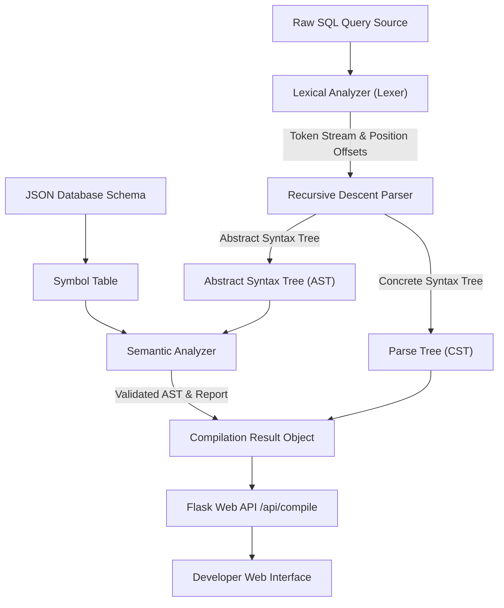

# System Architecture

## 1. Architectural Overview
The **Mini SQL Compiler** follows the classical pipeline architecture of language compilers, strictly decomposing the compilation process into distinct sequential phases. Each phase consumes the structured output of its predecessor and either produces an enriched intermediate data structure or aborts with localized diagnostics.



---

## 2. Component Directory Architecture

```
mini-sql-compiler/
├── app.py                      # Flask Application Controller & REST API
├── requirements.txt            # Python Dependencies
├── README.md                   # Project Overview & Quickstart Guide
├── CONTRIBUTING.md             # Git Workflow & Team Collaboration Guide
├── LICENSE                     # Open Source MIT License
├── .gitignore                  # Git Exclusion Configuration
│
├── compiler/                   # Core Compiler Package
│   ├── __init__.py             # Module Exports
│   ├── tokens.py               # Token Types & Data Class
│   ├── errors.py               # Error Class Hierarchy (Lexical/Syntax/Semantic)
│   ├── lexer.py                # Lexical Scanner & Comment Handler
│   ├── grammar.py              # CFG Productions & FIRST/FOLLOW Sets
│   ├── parser.py               # LL(1) Recursive Descent Parser
│   ├── parse_tree.py           # Concrete Syntax Tree Node & Visualizers
│   ├── ast_nodes.py            # Abstract Syntax Tree Data Structures
│   ├── symbol_table.py         # Schema Catalog & Fuzzy Matcher
│   ├── semantic_analyzer.py    # Type & Reference Checker
│   └── compiler.py             # Master Pipeline Coordinator
│
├── frontend/                   # Web User Interface
│   ├── templates/
│   │   └── index.html          # Semantic HTML5 Layout
│   └── static/
│       ├── css/
│       │   └── style.css       # Dark-Mode Styling & Responsive Layout
│       ├── js/
│       │   └── script.js       # Client Controller & Dynamic Tab Handlers
│       └── images/             # Static Assets
│
├── schema/
│   └── sample_schema.json      # In-Memory Database Schema Definitions
│
├── tests/                      # Automated Test Suite (60 Test Cases)
│   ├── __init__.py
│   ├── test_lexer.py           # Tokenizer Unit Tests
│   ├── test_parser.py          # Syntax Analysis Unit Tests
│   ├── test_parse_tree.py      # Tree Serialization Unit Tests
│   ├── test_semantic.py        # Schema & Type Verification Unit Tests
│   ├── test_compiler.py        # End-to-End Pipeline Integration Tests
│   └── test_cases.md           # Test Cases Execution Matrix
│
└── docs/                       # Comprehensive Academic Documentation
    ├── project_introduction.md
    ├── objectives.md
    ├── problem_statement.md
    ├── system_architecture.md
    ├── compiler_phases.md
    ├── lexical_analysis.md
    ├── syntax_analysis.md
    ├── parse_tree_explanation.md
    ├── semantic_analysis.md
    ├── error_handling.md
    ├── testing_and_results.md
    ├── limitations_and_future_scope.md
    ├── project_report.md
    ├── viva_questions.md
    └── individual_contributions.md
```

---

## 3. Data Flow and Phase Transitions

1. **Input Phase:** The user enters a SQL statement via the browser interface or automated test harness.
2. **Lexical Scanning (`lexer.py`):** The lexer scans characters, strips comments, and produces a `List[Token]`. If an illegal character or unterminated string is detected, a `LexicalError` is raised, halting compilation.
3. **Syntax Analysis (`parser.py`):** The parser matches tokens against the non-left-recursive CFG using single-token lookahead. It simultaneously constructs the Concrete Syntax Tree (`ParseTreeNode`) and Abstract Syntax Tree (`QueryNode`). If grammar rules are breached, a `SyntaxError` is raised with line and column numbers.
4. **Semantic Validation (`semantic_analyzer.py`):** The AST is walked to resolve table identifiers and column names against the `SymbolTable`. Types in comparison operators are checked for compatibility. If a schema violation occurs, a `SemanticError` is raised.
5. **Output Presentation (`compiler.py` & `app.py`):** The `CompilationResult` is packaged into a JSON dictionary and displayed across responsive UI tabs.
